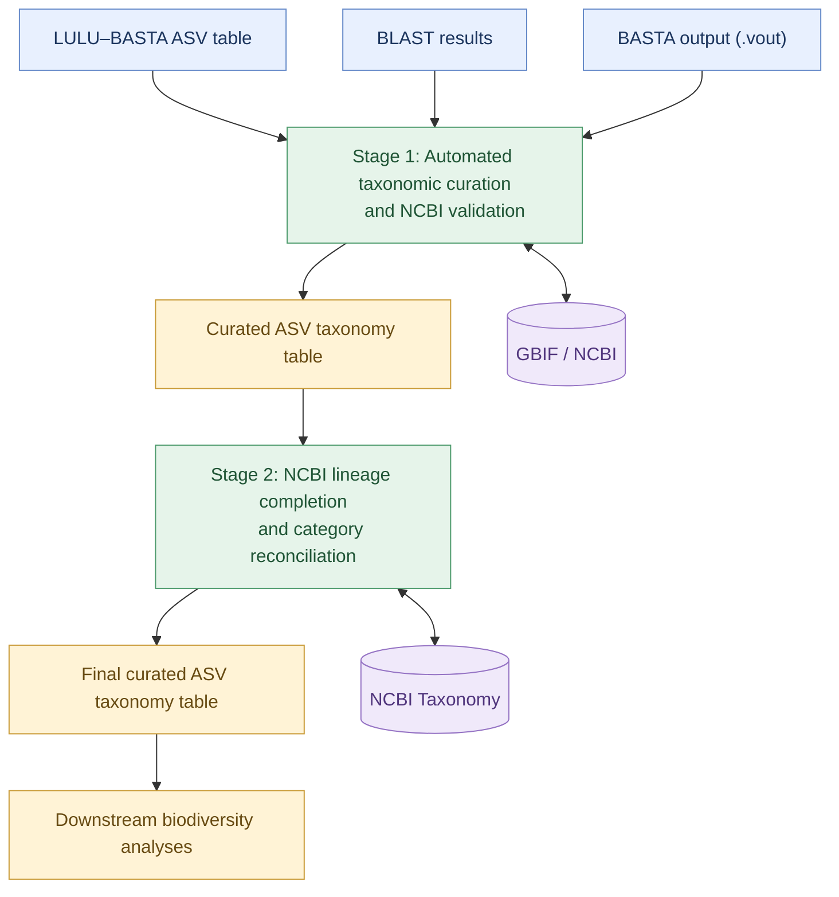

# Taxonomic Assignment Validation and Automated Curation

Technical documentation for a reproducible, marker-adaptable workflow integrating taxonomic assignment evidence, automated curation, NCBI validation, and taxonomic lineage completion.

## 1. Overview

### 1.1. Background and rationale

Taxonomic curation is an essential but often time-consuming step in DNA metabarcoding, particularly when working with large datasets containing thousands of amplicon sequence variants (ASVs). Manually evaluating taxonomic assignments, resolving inconsistencies, and verifying classifications against reference databases can require substantial effort.

This R-based workflow automates much of the taxonomic curation process by integrating evidence from multiple sources, applying standardized decision rules, and validating assignments against external taxonomic databases. By processing large numbers of ASVs systematically, it substantially reduces manual workload and accelerates taxonomic curation, while flagging uncertain assignments for further review.

### 1.2. Workflow scope

The workflow integrates taxonomic assignments generated through LULU–BASTA and BLAST-based analyses, incorporates reference information from GBIF and NCBI, and applies automated rules to produce curated ASV classifications.

It consists of two sequential stages:

1. **Automated taxonomic curation and NCBI validation:** integrates taxonomic evidence, evaluates assignments, applies curation rules, and identifies classifications requiring manual review.
2. **NCBI-based taxonomic lineage completion:** fills missing taxonomic ranks when supported by NCBI taxonomy and reconciles curation categories with the resulting classifications.

The workflow begins with previously generated taxonomic assignment files. It does not perform raw-read processing, ASV inference, BLAST searches, or the initial LULU–BASTA analysis.

### 1.3. Marker adaptability

The workflow can be applied to different molecular markers, provided that the required taxonomic assignment files follow the expected input structure.

Users can adapt the workflow by configuring input and output paths, target taxonomic groups, and other relevant parameters. Marker-specific characteristics, including sequence length and taxonomic resolution, should be considered when selecting appropriate settings.

The general workflow is described in this document, while the implementation details, configuration parameters, and decision rules of each script are documented separately.

---


## 2. Workflow Architecture

The workflow consists of two sequential R scripts. The first integrates taxonomic evidence and performs automated curation and NCBI validation. The second completes missing taxonomic ranks and reconciles the final curation categories.

### 2.1. Workflow diagram



### 2.2. Execution sequence

1. **Prepare the input files:** provide the LULU–BASTA ASV table, BLAST results, and BASTA output.
2. **Run automated taxonomic curation:** integrate taxonomic evidence, validate assignments, and generate the curated ASV table.
3. **Run NCBI lineage completion:** complete supported missing taxonomic ranks and reconcile curation categories.
4. **Use the final dataset:** the completed taxonomic table is ready for downstream biodiversity analyses, subject to any required manual review.

Detailed configuration instructions and internal decision rules are provided in the documentation for each script.
```

